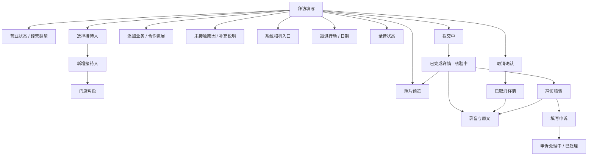

# 拜访全流程 V3 · 设计评审稿

2026-11-17。状态：**用户已批准，已按本方案实施 APP 页面**。2026-11-17 用户明确要求一并实现拜访填写、已完成详情及内部子页面，并保留业务逻辑与拍照修复、在 Redmi 验证。实施与测试证据见 `docs/app-visit-flow-v3.md`。原型中的示例数据仍仅用于设计展示。

## 查看方式

- `index.html`：可点击的单屏原型；左侧目录可切换全部 39 个页面、面板和状态。
- `index.html?view=all`：全量画板；每个手机内部均可滚动并继续点击。
- `主页面总览.png`：填写上下半屏、完成详情、原文四屏对比。
- `screens/`：全部单屏 PNG，包括两张长页面的底部。
- 本地预览：`http://127.0.0.1:8769/`；服务停止后可直接用浏览器打开 `index.html`。

## 本轮设计范围

起点是正在填写的拜访与已完成拜访详情，向内覆盖现有入口。客户详情、拜访列表、系统相机内部 UI、系统权限对话框不是本轮自定义页面。系统相机的入口、响应和返回状态纳入设计。未增加当前接口没有的 AI 总结、核验分项分数、附件申诉或录音导出。

| 分组 | 设计视图 |
| --- | --- |
| 主流程（4） | 拜访填写、未接触填写、已完成详情、已取消详情 |
| 接待人与业务（5） | 选择接待人、新增接待人、角色选择、添加业务、合作进展 |
| 填写辅助（6） | 营业状态、经营类型、未接触原因、跟进行动、日期、取消确认 |
| 照片与录音（7） | 相机入口、录音状态、照片预览、完整录音、原文、转写处理中、暂无已同步录音 |
| 核验与申诉（8） | 核验通过、未通过、证据不足、自动核验中、申诉填写、申诉处理中、申诉已处理、核验处理异常 |
| 反馈与异常（9） | 停业依据、其他未接触原因、暂无合作意向、必填错误、材料待同步、录音中断、提交中、提交成功、加载失败 |

## 页面关系

## 视觉与交互决策

沿用 MASTER 的白底、石墨正文 #252A31、辅助文字 #626970、操作橙 #C64C1C、浅橙 #FFF2EA；灰色背景只用于输入、材料与状态容器，不给每块信息都套卡片。辅助成功色 #256547，失败 #B42318，状态同时有文字与符号。

中文系统字体；门店标题 21px、导航 17px、分区 16px、正文 15–16px、次级信息 14px、时间与注释 12px。手机左右 20px、区块 24px、字段行至少 52px、主要按钮 50px、文字及图标触控目标 48px。横屏内容可滚动；正式原生实现应保持主内容最大 560px、软键盘和安全区适配，不能把桌面评审栏带进 APP。

1. 填写页：门店摘要 → 录音状态 → 门店现状 → 本次沟通 → 现场照片 → 后续跟进。录音状态默认收起，底部仅保留取消与完成。
2. 详情页：核验摘要 → 沟通记录 → 门店现状 → 现场材料 → 后续跟进。移除表单选择器和必填符号；长记录自然换行，不放进禁用 textarea。
3. 接待人建议改为多选底部面板；新增接待人仍在原页面面板完成。选择角色后保留姓名、电话、微信；保存成功自动选中。
4. 合作意向与合作关系在同一面板内分组，但底层仍沿用已有字典和互斥规则。已合作不被解释为订单成交或正式业绩。
5. 申诉建议从结果页的内嵌长表单改为独立填写子页；仅改变呈现方式，仍只提交 reason 和 revision，不增加材料上传或新审核机制。
6. 日期与相机采用原生系统能力。原型中是示意，不是要求开发自制相机或日历。

## 状态与业务约束

- 规则数量、字典、权限、canAppeal、历史冻结名称均以原接口为准。示例中的 1 张照片、字典名称、联系人、地址、时间、录音原文均为设计演示，禁止硬编码成生产默认值。
- 停业需要依据；其他未接触需要说明；跟进行动与日期成对填写。未接触不提交隐藏的接待人和业务信息。切换或返回不能清空已填草稿。
- 系统相机即时打开；拍后定位校验、保存、同步仍沿用既有修复。不能绕过现场规则，也不能把本机保存等同于同步成功。
- 拜访提交成功显示“自动核验中”，不提前显示“有效拜访”。通过、失败、证据不足、系统处理异常分别呈现。
- 核验页当前接口只有整体状态、原因和申诉记录；本设计不虚构定位核验、照片核验、AI 分数或阶段时间轴。
- 申诉入口只有 canAppeal 为真才显示。处理中不重复提交；已处理显示决定和说明。原型的未通过及证据不足示例假定 canAppeal 为真。
- 原文只有识别出的说话人才显示名字；无分段时间戳时显示普通原文，不伪造定位。连续播放保留跨段逻辑，返回停止播放。
- 自动录音模式不提供随意暂停；手动录音的原有规则及开始/停止操作不能因该示例省略而删除。
- 取消停止录音，不计完成；保留原始材料。加载失败不使用空表单覆盖草稿。

## 技能依据与边界

使用 ui-ux-pro-max。`CRM mobile productivity minimal --design-system` 命中 Flat Design，采用低装饰、清晰线条和触控建议；营销落地页结构、蓝绿配色、Inter 字体不适用，未写入基线。`form inline validation --domain ux` 命中就近校验与提交反馈，采用字段级错误和明确阶段反馈。参考 quick-reference §1–§3 和原生 pro-rules。原生项目为 uni-app x，技能没有该 stack，未假用 Web Vue 指南作为原生兼容证据。

本稿为浅色应用方案，沿用既有产品主题；照片查看器的暗底仅用于聚焦照片，不表示新增全局深色模式。无装饰动画。平台日期控件、原生软键盘及当前设备安全区已完成 Redmi 检查；大字体、读屏焦点和 iOS/Harmony 真机交互仍待设备验收。

## 原型验证

- 39 个视图均成功渲染，浏览器无脚本错误、无页面横向溢出。
- 375px 小屏检查；812×375 横屏的长面板内部可滚动；减少动画偏好下正常呈现。
- 点选链路：接待人 → 新增 → 角色 → 保留输入 → 保存选中；提交成功 → 自动核验中；核验未通过 → 填写申诉 → 处理中。
- 所有本稿示例操作只改变页面内存，不保存真实联系人、不提交拜访或申诉、不播放或采集实际音频。
- 浏览器原型检查不等同于 Android/iOS/HarmonyOS 原生验收；尚未获得用户视觉确认。详细机器检查见 validation.json。
